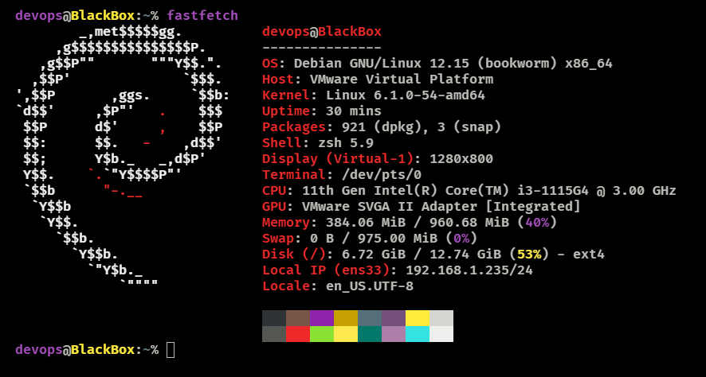
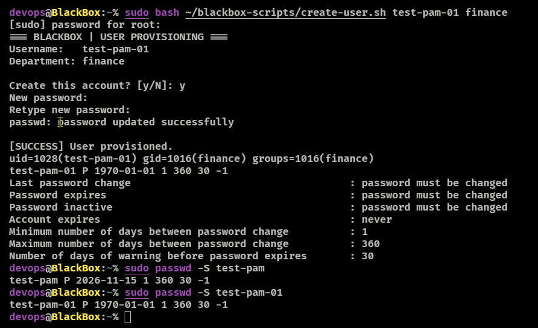
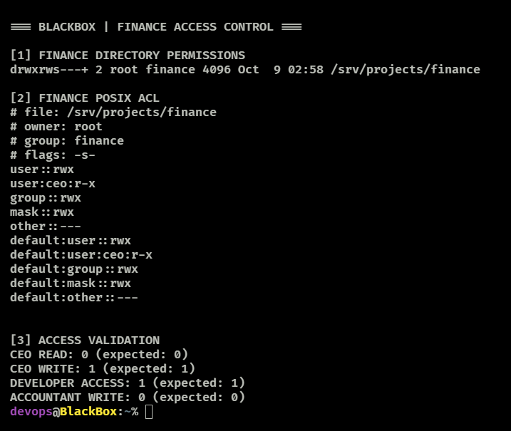
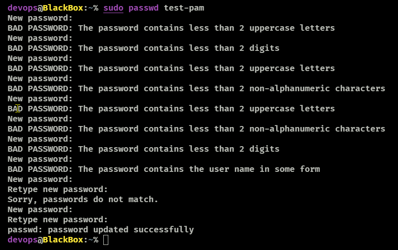
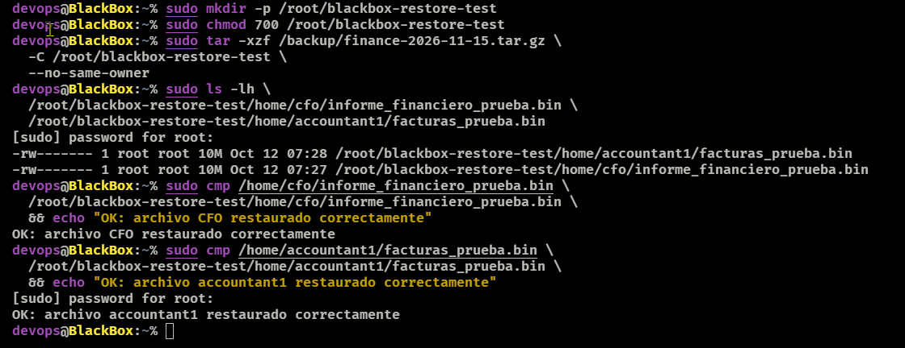

[🇬🇧 Read in English](README.md)

# Linux Server Hardening

> Laboratorio práctico de administración y securización de servidores Linux que abarca gestión de usuarios, control de accesos, seguridad de contraseñas, automatización con Bash, auditoría del sistema y copias de seguridad.

---

## 🖥️ Entorno del sistema

## Implementación de seguridad y documentación técnica

**BlackBox** es un laboratorio práctico de administración y seguridad Linux diseñado para simular un entorno empresarial con restricciones de acceso departamentales y acceso controlado a recursos financieros.

Las siguientes secciones describen las configuraciones implementadas y validadas en el servidor, incluyendo las decisiones técnicas, los controles de seguridad y las evidencias correspondientes.

---

# 1. Gestión de usuarios y grupos

### Descripción general

BlackBox incluye **21 cuentas de usuario locales**, distribuidas entre siete grupos organizativos y administrativos: Finanzas, Dirección, Recursos Humanos, Marketing, Desarrollo, Soporte IT y Administradores.

El modelo de gestión de identidades separa a los usuarios por departamentos y permite asignar y verificar sus pertenencias a los grupos correspondientes.

### Tecnologías y herramientas

`Linux` · `useradd` · `usermod` · `groupadd` · `id` · `getent` · `/etc/passwd`

### Implementación

- Creación y administración de cuentas de usuario locales.
- Organización de usuarios en grupos departamentales y administrativos.
- Configuración de pertenencia a grupos según las responsabilidades organizativas.
- Verificación de identidades y asignaciones mediante herramientas nativas de Linux.

### Validación y evidencias

Las cuentas y pertenencias a grupos se comprobaron mediante comandos como `id`, `getent` y la consulta de `/etc/passwd`.

*Figura 1. Validación del aprovisionamiento y administración de cuentas de usuario en BlackBox.*

### Competencias técnicas demostradas

`Administración de usuarios Linux` · `Gestión de grupos` · `Verificación de identidades` · `Organización departamental` · `Administración de cuentas`

### Documentación técnica

- [Gestión de usuarios y grupos — Español](docs/user-management.es.md)
- [User & Group Management — English](docs/user-management.md)

---

# 2. Control de acceso departamental — SGID y ACL POSIX

### Descripción general

Se implementaron directorios compartidos por departamento bajo `/srv/projects/`, utilizando propietarios y grupos Linux, permisos Unix, SGID y listas de control de acceso POSIX (ACL).

El objetivo es restringir el acceso según las responsabilidades de cada departamento y permitir accesos adicionales expresamente autorizados.

### Tecnologías y herramientas

`Linux` · `chmod` · `chown` · `SGID` · `setfacl` · `getfacl` · `ACL POSIX`

### Implementación

Se verificó la siguiente configuración de directorios departamentales:

| Departamento | Directorio | Permisos | SGID |
|---|---|---|---|
| Finanzas | `/srv/projects/finance` | `2770` + ACL | Activado |
| Dirección | `/srv/projects/management` | `2770` | Activado |
| Recursos Humanos | `/srv/projects/human-resources` | `2770` | Activado |
| Marketing | `/srv/projects/marketing` | `2770` | Activado |
| Desarrollo | `/srv/projects/developers` | `2770` | Activado |

El directorio de Finanzas incorpora una ACL POSIX adicional que permite al CEO leer y recorrer el directorio, sin concederle permisos de escritura.

### Validación y evidencias

Las pruebas de control de acceso confirmaron el siguiente comportamiento:

| Prueba | Comportamiento esperado | Resultado |
|---|---|---|
| CEO → Finanzas | Lectura permitida | SUPERADA |
| CEO → Finanzas | Escritura denegada | SUPERADA |
| Desarrollador → Finanzas | Acceso al directorio denegado | SUPERADA |
| Contable → Finanzas | Escritura permitida | SUPERADA |

Estas pruebas validan el comportamiento de acceso a nivel de directorio. Los permisos de archivos individuales y la herencia de SGID requieren pruebas específicas adicionales.

*Figura 2. Comprobación de las restricciones de acceso mediante permisos Unix y ACL POSIX.*

### Competencias técnicas demostradas

`Permisos Unix` · `Control de acceso departamental` · `Configuración SGID` · `Administración de ACL POSIX` · `Principio de mínimo privilegio` · `Validación de accesos`

### Documentación técnica

- [Permisos, SGID y ACL POSIX — Español](docs/file-permissions.es.md)
- [File Permissions, SGID & POSIX ACLs — English](docs/file-permissions.md)

---

# 3. Seguridad de contraseñas y automatización de usuarios

### Descripción general

BlackBox implementa una política centralizada de seguridad de contraseñas mediante PAM, `pam_pwquality` y un diccionario personalizado de CrackLib con términos en inglés, castellano y catalán/valenciano.

Un script de aprovisionamiento en Bash facilita la creación consistente de usuarios, la asignación de grupos departamentales y la configuración del ciclo de vida de las contraseñas.

### Tecnologías y herramientas

`Linux` · `PAM` · `pam_pwquality` · `CrackLib` · `chage` · `Bash` · `/etc/skel`

### Implementación

- Configuración de requisitos de complejidad de contraseñas.
- Implementación de comprobaciones de similitud con el nombre de usuario y validación mediante diccionarios.
- Aplicación de la política de contraseñas al usuario root.
- Creación de un diccionario multilingüe personalizado para la validación.
- Configuración de una **política de caducidad de 1/360/30 días**:
  - Antigüedad mínima: 1 día.
  - Antigüedad máxima: 360 días.
  - Aviso previo a la caducidad: 30 días.
- Configuración del cambio obligatorio de contraseña en el primer inicio de sesión.
- Automatización del aprovisionamiento de usuarios locales y su asignación a grupos mediante Bash.

### Validación y evidencias

Las pruebas incluyeron la validación del rechazo de contraseñas, la configuración de caducidad y el aprovisionamiento de usuarios.

*Figura 3. Prueba de rechazo de contraseñas que incumplen la política de seguridad configurada.*

**Evidencias adicionales:**

- [Configuración de la política de contraseñas PAM](screenshots/pam-password-policy.png)
- [Validación de la caducidad de contraseñas](screenshots/password-aging-validation.png)
- [Diccionarios multilingües de CrackLib](screenshots/cracklib-multilingual-dictionaries.png)

### Competencias técnicas demostradas

`Configuración PAM` · `Aplicación de políticas de contraseñas` · `Securización de autenticación` · `Gestión del ciclo de vida de contraseñas` · `Scripting Bash` · `Automatización de usuarios`

### Documentación técnica

- [Seguridad de contraseñas — Español](docs/password-security.es.md)
- [Password Security Policy — English](docs/password-security.md)
- [Automatización de usuarios — Español](docs/user-automation.es.md)
- [Automated User Provisioning — English](docs/user-automation.md)

---

# 4. Copias de seguridad automatizadas y recuperación

### Descripción general

Se implementó una solución automatizada de copias de seguridad y recuperación para el departamento financiero de BlackBox, centrada en la protección de datos, la fiabilidad operativa y la administración segura del servidor.

El sistema utiliza un script Bash para crear, verificar y gestionar archivos comprimidos, con programación diaria mediante cron.

### Tecnologías y herramientas

`Linux` · `Bash` · `cron` · `tar` · `gzip` · `flock` · `find` · `cmp`

### Implementación

- **Automatización diaria:** Copias programadas a las **02:00** mediante el crontab de root.
- **Protección de datos:** Backups de `/home/cfo` y `/home/accountant1`.
- **Verificación de integridad:** Comprobaciones GZIP y TAR antes de publicar cada archivo.
- **Protección contra concurrencia:** Bloqueo exclusivo mediante `flock` para impedir ejecuciones simultáneas.
- **Prevención de sobrescrituras:** Protección frente al reemplazo accidental de copias existentes.
- **Retención de 30 días:** Eliminación automatizada de copias antiguas mediante `find`, validada en un laboratorio aislado.
- **Permisos restrictivos:** Directorio de backups con permisos `700` y nuevos archivos con permisos `600`.
- **Pruebas de recuperación:** Restauración controlada y comparación de archivos mediante `cmp`.
- **Registro de operaciones:** Logs con marcas de tiempo para documentar copias, errores y operaciones de retención.

### Validación y evidencias

Se completaron correctamente las siguientes comprobaciones:

| Prueba | Resultado |
|---|---|
| Creación del backup | SUPERADA |
| Verificación de integridad GZIP | SUPERADA |
| Verificación de estructura TAR | SUPERADA |
| Restauración controlada | SUPERADA |
| Comparación de archivos restaurados | SUPERADA |
| Prevención de copias duplicadas | SUPERADA |
| Permisos restrictivos | SUPERADA |
| Eliminación por retención en laboratorio aislado | SUPERADA |
| Registro de operaciones de retención | SUPERADA |
| Despliegue del script en producción | COMPLETADO |
| Configuración del cron de root | VERIFICADA |

La nueva versión del script se desplegó en producción y se verificó la configuración de la tarea diaria de cron. La ejecución automática correcta de la versión actualizada deberá confirmarse mediante los registros posteriores de producción.

*Figura 4. Validación de la recuperación de archivos desde una copia de seguridad de BlackBox.*

**Evidencia adicional:**

- [Verificación de integridad de backups](screenshots/backup-integrity.png)

### Competencias técnicas demostradas

`Administración de backups Linux` · `Automatización Bash` · `Programación con cron` · `Verificación de integridad` · `Control de concurrencia` · `Gestión de retención` · `Permisos seguros` · `Pruebas de recuperación`

### Documentación técnica

- [Copias de seguridad y recuperación — Español](docs/backup-and-recovery.es.md)
- [Backup & Recovery — English](docs/backup-and-recovery.md)

---

## Arquitectura del sistema

Para consultar una visión global del entorno BlackBox, sus componentes de seguridad y la relación entre los módulos implementados:

- [Arquitectura del sistema — Español](docs/Architecture.es.md)
- [System Architecture — English](docs/Architecture.md)

---

## Alcance del proyecto y futuras mejoras

BlackBox es un laboratorio práctico de administración y seguridad Linux. Demuestra competencias de configuración, automatización y validación, pero no pretende representar una infraestructura empresarial de producción completa.

Entre las posibles mejoras futuras se encuentran:

- Ampliación de la documentación de `auditd` y validación de eventos de seguridad.
- Monitorización y alertas de seguridad centralizadas.
- Copias de seguridad cifradas y almacenadas externamente.
- Notificaciones automáticas ante fallos de backup.
- Pruebas periódicas y programadas de recuperación.
- Comprobaciones adicionales de cumplimiento de seguridad.

Estas mejoras se plantean como trabajo futuro, no como funcionalidades ya implementadas.

---

## Competencias técnicas generales

`Administración de sistemas Linux` · `Gestión de identidades y accesos` · `Securización de sistemas` · `PAM` · `Permisos Unix` · `SGID` · `ACL POSIX` · `Automatización Bash` · `Cron` · `Copias de seguridad y recuperación` · `Documentación técnica`

---

**BlackBox — Linux Server Hardening**

*Administración práctica de Linux, implementación de controles de seguridad, automatización y validación técnica.*
