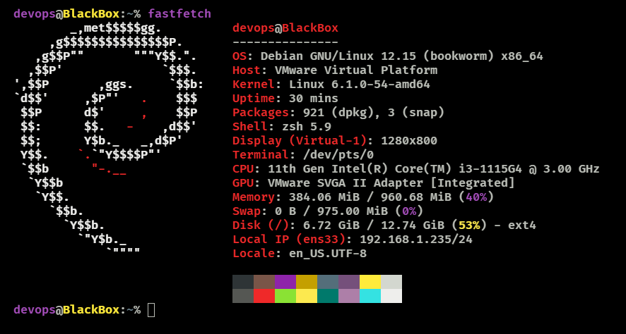

[🇬🇧 Read in English](README.md)

#  linux-server-hardening

> Laboratorio de seguridad en servidores Linux centrado en gestión de usuarios, control de acceso, auditoría, automatización en Bash y copias de seguridad.

---

### 🖥️ Entorno del Sistema

## Implementación de Seguridad y Documentación Técnica

**BlackBox** es un laboratorio de administración y seguridad de sistemas Linux diseñado para simular un entorno corporativo con restricciones de acceso por departamentos y acceso controlado a recursos financieros.

La siguiente documentación describe las configuraciones implementadas y verificadas en el servidor.

### 1. Gestión de Usuarios y Grupos

Se identificaron **21 cuentas de usuario locales**, distribuidas entre siete grupos organizativos y administrativos: Finanzas, Dirección, Recursos Humanos, Marketing, Desarrollo, Soporte Informático y Administradores.

**Competencias técnicas demostradas:**

- Administración de usuarios y grupos en Linux.
- Organización de usuarios por departamentos.
- Gestión de accesos basada en roles mediante grupos Unix.
- Verificación de cuentas y pertenencia a grupos utilizando `id`, `getent` y `/etc/passwd`.

**Documentación:** [Gestión de Usuarios y Grupos](docs/user-management.es.md) | [Versión en inglés](docs/user-management.md)

### 2. Control de Acceso Departamental — SGID y ACLs POSIX

Se configuraron directorios compartidos por departamento en `/srv/projects/`, utilizando propietarios, grupos, permisos Unix, SGID y listas de control de acceso POSIX (ACLs).

**Configuración verificada:**

| Departamento | Directorio | Permisos | SGID |
|---|---|---|---|
| Finanzas | `/srv/projects/finance` | `2770` + ACL | Activado |
| Dirección | `/srv/projects/management` | `2770` | Activado |
| Recursos Humanos | `/srv/projects/human-resources` | `2770` | Activado |
| Marketing | `/srv/projects/marketing` | `2770` | Activado |
| Desarrollo | `/srv/projects/developers` | `2770` | Activado |

El directorio de Finanzas dispone de una ACL POSIX adicional que concede al usuario `ceo` permisos de lectura y recorrido del directorio, sin otorgarle permisos de escritura.

**Resultados de las pruebas de control de acceso:**

| Prueba | Comportamiento esperado | Resultado |
|---|---|---|
| CEO → Finanzas | Lectura permitida | CORRECTO |
| CEO → Finanzas | Escritura denegada | CORRECTO |
| Desarrollador → Finanzas | Acceso al directorio denegado | CORRECTO |
| Contable → Finanzas | Escritura permitida | CORRECTO |

Estas pruebas verifican el comportamiento de los permisos a nivel de directorio. Los permisos de los archivos individuales y la herencia efectiva mediante SGID requieren comprobaciones adicionales.

**Documentación:** [Permisos, SGID y ACLs POSIX](docs/file-permissions.es.md) | [Versión en inglés](docs/file-permissions.md)

### Competencias Técnicas Demostradas

`Administración Linux` · `Gestión de Usuarios y Grupos` · `Permisos Unix` · `SGID` · `ACLs POSIX` · `Control de Acceso` · `Bash` · `Documentación de Seguridad`
