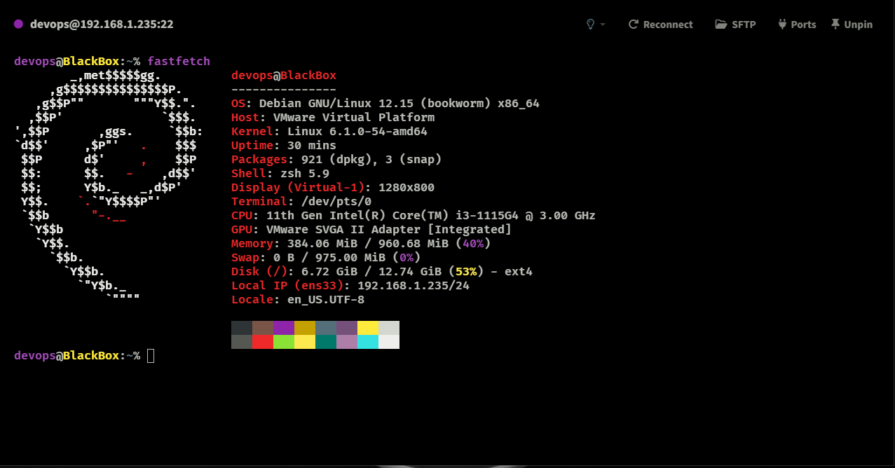

# linux-server-hardening
-- Linux server hardening lab: user management, access control, auditing, Bash automation and backups.
-- Laboratorio de seguridad Linux: gestión de usuarios, permisos, auditoría, automatización y copias de seguridad.

