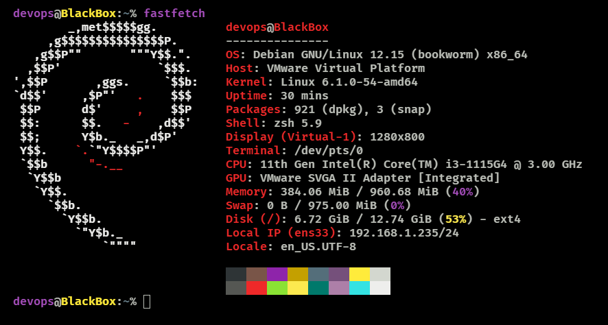

# linux-server-hardening

> 🇬🇧 **EN:** Linux server hardening lab covering user management, access control, system auditing, Bash automation, and backups.  
> 🇪🇸 **ES:** Laboratorio de seguridad en servidores Linux centrado en gestión de usuarios, control de acceso, auditoría, automatización en Bash y copias de seguridad.

---

### 🖥️ System Environment / Entorno del Sistema

linux-server-hardening/
├── README.md
├── docs/
│   ├── user-management.md
│   ├── user-management.es.md
│   ├── file-permissions.md
│   └── file-permissions.es.md
├── scripts/
├── configs/
├── automation/
├── screenshots/
│   └── finance-acl-validation.png
└── tests/
