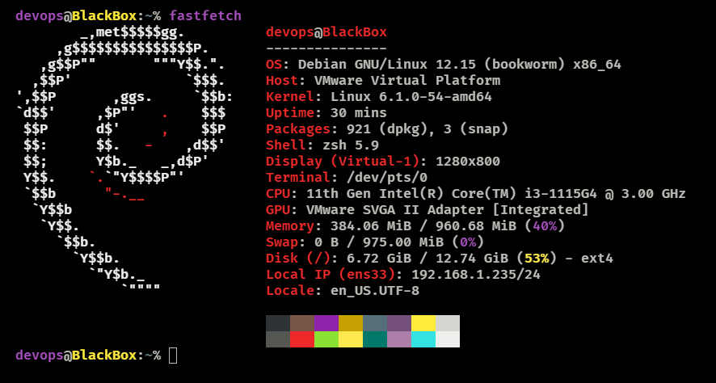
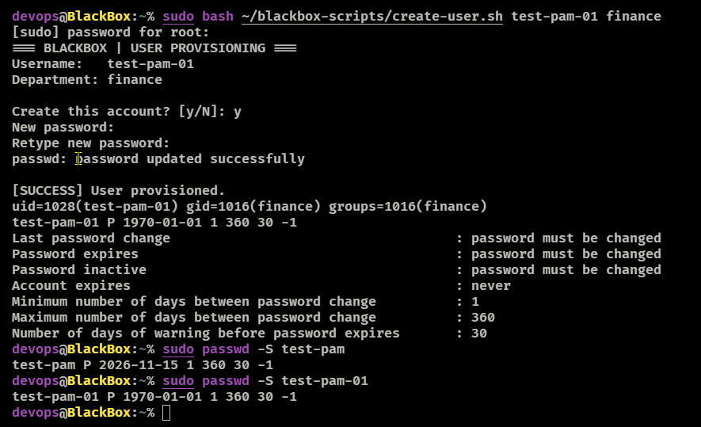
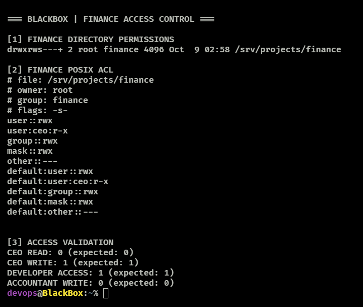
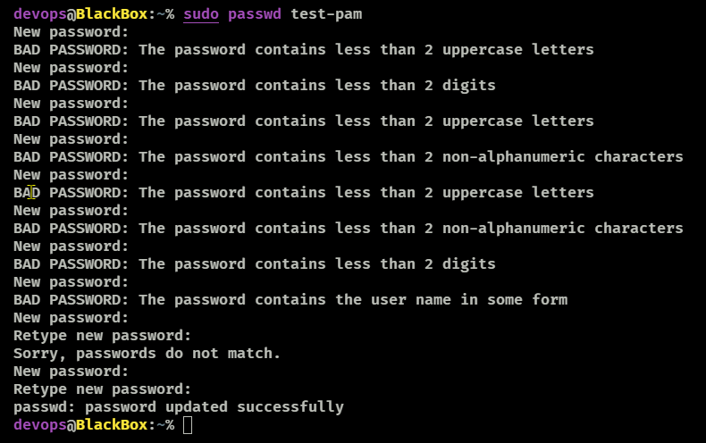
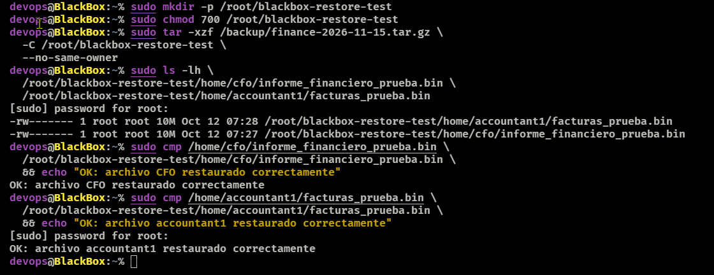
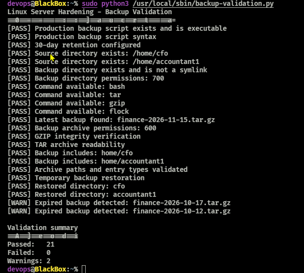
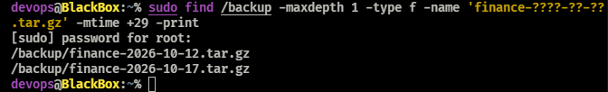
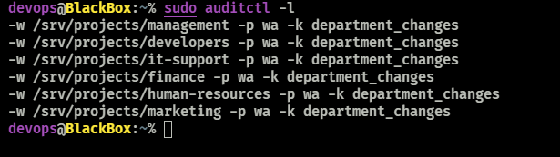

[🇪🇸 Leer en Español](README.es.md)

# Linux Server Hardening

> Hands-on Linux server hardening lab covering user management, departmental access control, password security, Bash automation, system auditing, and backup and recovery.

> **Project status: In active development.** Implemented security controls are documented with hands-on validation and evidence. Additional improvements are tracked in [Project Scope & Future Improvements](#project-scope--future-improvements).

---

## 🖥️ System Environment



## Security Implementation & Technical Documentation

**Linux Server Hardening** is a Linux system administration and security lab designed to simulate a corporate environment with departmental access restrictions and controlled access to financial resources.

The following sections describe configurations implemented and validated on the server, including technical decisions, security controls, and supporting evidence.

---

# 1. User & Group Management

### Overview

Linux Server Hardening includes **21 local user accounts** across seven organizational and administrative groups: Finance, Management, Human Resources, Marketing, Developers, IT Support, and Administrators.

The identity management model separates users by department and supports the assignment and verification of group memberships.

### Technologies & Tools

`Linux` · `useradd` · `usermod` · `groupadd` · `id` · `getent` · `/etc/passwd`

### Implementation

- Created and managed local Linux user accounts.
- Organized users into departmental and administrative groups.
- Configured group membership according to organizational responsibilities.
- Verified user identities and group assignments using native Linux administration tools.

### Validation & Evidence

User accounts and group memberships were checked using commands such as `id`, `getent`, and `/etc/passwd` inspection.



### Technical Skills Demonstrated

`Linux User Administration` · `Group Management` · `Identity Verification` · `Departmental Organization` · `Account Management`

### Technical Documentation

- [User & Group Management — English](docs/user-management.md)
- [Gestión de usuarios y grupos — Español](docs/user-management.es.md)

---

# 2. Departmental Access Control — SGID & POSIX ACLs

### Overview

Implemented departmental shared directories under `/srv/projects/` using Linux ownership, Unix permissions, SGID, and POSIX Access Control Lists.

The objective is to restrict access according to departmental responsibilities while allowing explicitly authorized cross-department access.

### Technologies & Tools

`Linux` · `chmod` · `chown` · `SGID` · `setfacl` · `getfacl` · `POSIX ACLs`

### Implementation

The following departmental directory configuration was verified:

| Department | Directory | Permissions | SGID |
|---|---|---|---|
| Finance | `/srv/projects/finance` | `2770` + ACL | Enabled |
| Management | `/srv/projects/management` | `2770` | Enabled |
| Human Resources | `/srv/projects/human-resources` | `2770` | Enabled |
| Marketing | `/srv/projects/marketing` | `2770` | Enabled |
| Developers | `/srv/projects/developers` | `2770` | Enabled |

The Finance directory includes an additional POSIX ACL granting the CEO read and traversal permissions without granting write access.

### Validation & Evidence

Access-control tests confirmed the following behavior:

| Test | Expected behavior | Result |
|---|---|---|
| CEO → Finance | Read permitted | PASS |
| CEO → Finance | Write denied | PASS |
| Developer → Finance | Directory traversal denied | PASS |
| Accountant → Finance | Write permitted | PASS |

These tests validate directory-level access behavior. Individual file permissions and SGID inheritance behavior require separate testing.



### Technical Skills Demonstrated

`Unix File Permissions` · `Departmental Access Control` · `SGID Configuration` · `POSIX ACL Management` · `Least Privilege` · `Access Control Validation`

### Technical Documentation

- [File Permissions, SGID & POSIX ACLs — English](docs/file-permissions.md)
- [Permisos, SGID y ACL POSIX — Español](docs/file-permissions.es.md)

---

# 3. Password Security & User Automation

### Overview

Linux Server Hardening implements a centralized password security policy using PAM, `pam_pwquality`, and a custom multilingual CrackLib dictionary covering English, Spanish, and Catalan/Valencian.

A Bash provisioning script supports consistent user creation, departmental group assignment, and password lifecycle configuration.

### Technologies & Tools

`Linux` · `PAM` · `pam_pwquality` · `CrackLib` · `chage` · `Bash` · `/etc/skel`

### Implementation

- Configured password complexity requirements.
- Implemented username similarity and dictionary-based password checks.
- Applied password policy enforcement to root.
- Created a custom multilingual dictionary for password validation.
- Configured password aging with a **1/360/30-day policy**:
  - Minimum password age: 1 day.
  - Maximum password age: 360 days.
  - Expiration warning: 30 days.
- Configured mandatory password changes at first login.
- Automated local user provisioning and departmental group assignment using Bash.

### Validation & Evidence

Password-policy tests included validation of password rejection behavior, password aging configuration, and user provisioning.



Additional evidence:

- [PAM password policy configuration](screenshots/pam-password-policy.png)
- [Password aging validation](screenshots/password-aging-validation.png)
- [Multilingual CrackLib dictionaries](screenshots/cracklib-multilingual-dictionaries.png)

### Technical Skills Demonstrated

`PAM Configuration` · `Password Policy Enforcement` · `Authentication Hardening` · `Password Lifecycle Management` · `Bash Scripting` · `User Provisioning Automation`

### Technical Documentation

- [Password Security Policy — English](docs/password-security.md)
- [Seguridad de contraseñas — Español](docs/password-security.es.md)
- [Automated User Provisioning — English](docs/user-automation.md)
- [Automatización de usuarios — Español](docs/user-automation.es.md)

---

# 4. Automated Backups & Recovery

### Overview

An automated backup and recovery solution was implemented for the Finance department within **Linux Server Hardening**, focusing on data protection, operational reliability, and secure Linux server administration.

The system combines a Bash script for backup creation and management with a Python validation tool, enabling reproducible checks of backup integrity, security, and recoverability.

Daily execution is scheduled through `cron` at **02:00 AM**, using root privileges.

### Technologies & Tools

`Linux` · `Bash` · `Python 3` · `cron` · `tar` · `gzip` · `flock` · `find` · `cmp` · `tarfile` · `pathlib` · `tempfile`

### Implementation

- **Daily automation:** Backups scheduled at **02:00 AM** through root's crontab.
- **Data protection:** Backups of `/home/cfo` and `/home/accountant1`.
- **Integrity verification:** GZIP and TAR checks before publishing each archive.
- **Concurrency protection:** Exclusive locking with `flock` to prevent simultaneous executions.
- **Overwrite prevention:** Safeguards against accidentally replacing existing backup archives.
- **30-day retention:** Automated cleanup of expired archives using `find`, previously validated in an isolated laboratory environment.
- **Restrictive permissions:** `/backup` directory permissions set to `700` and backup archive permissions set to `600`.
- **Operation logging:** Timestamped logs for backup executions, errors, and retention operations.
- **Controlled recovery:** File restoration and comparison against original files using `cmp`.
- **Automated validation:** An independent Python script checks the backup system without executing production backups or deleting existing archives.

### Validation & Evidence

#### Functional Validation and Recovery Testing

Manual tests were performed to verify backup creation, integrity, security, and recovery.

| Test | Result |
|---|---|
| Backup creation | PASSED |
| GZIP integrity verification | PASSED |
| TAR archive structure verification | PASSED |
| Controlled backup restoration | PASSED |
| Restored file comparison using `cmp` | PASSED |
| Duplicate backup prevention | PASSED |
| Restrictive file permissions | PASSED |
| Retention cleanup in an isolated laboratory | PASSED |
| Retention operation logging in the laboratory | PASSED |
| Production script deployment | COMPLETED |
| Root cron configuration | VERIFIED |



*Figure 4. Controlled backup restoration and verification of recovered files.*

**Additional evidence:**

- [Backup Integrity Verification](screenshots/backup-integrity.png)

#### Automated Backup Validation with Python

A Python validation tool, `tests/backup-validation.py`, was developed to automate backup system checks using only Python's standard library.

The validator performs the following operations:

- Checks the existence, executable permissions, and Bash syntax of the production backup script.
- Verifies Finance source directories and backup storage permissions.
- Checks the availability of required system utilities.
- Verifies the configured 30-day retention policy.
- Automatically selects the most recent production backup based on its filename date.
- Validates GZIP integrity and TAR archive readability.
- Confirms that the expected Finance directories are included in the archive.
- Validates archive entry paths and types before extraction.
- Performs temporary restoration in an isolated directory.
- Detects archives exceeding the retention threshold without deleting them.
- Produces `PASS`, `FAIL`, and `WARN` results with an exit code suitable for automation.

**Observed results from the production server:**

| Metric | Result |
|---|---|
| Successful checks | **21 PASS** |
| Failed checks | **0 FAIL** |
| Retention warnings | **2 WARN** |
| Validated backup | `finance-2026-11-15.tar.gz` |
| GZIP and TAR integrity | PASSED |
| Temporary restoration | PASSED |

The two warnings identified backup archives dated **October 12 and October 17, 2026**, which exceeded the configured retention threshold.

These results demonstrate that the validator can detect expired backup archives. Automatic retention cleanup in production still requires confirmation through an execution of the updated backup script.



*Figure 5. Python backup validation showing 21 successful checks and two retention warnings.*

**Retention detection evidence:**



*Figure 6. Automated detection of backup archives exceeding the 30-day retention threshold.*

#### Scheduling and Operational Monitoring

The backup job is configured in root's crontab:

```cron
0 2 * * * /usr/local/sbin/backup_finance.sh
```

The `cron` service was verified as active and enabled. System logs confirmed that cron launched the backup command on **November 15, 2026, at 02:00 AM**.

The production backup script was last modified on **November 19, 2026**. A subsequent scheduled execution is required to confirm automatic retention cleanup using the updated version.

### Technical Skills Demonstrated

`Linux Backup Administration` · `Bash Automation` · `Python Scripting` · `Cron Scheduling` · `Integrity Verification` · `Concurrency Control` · `Retention Management` · `Secure File Permissions` · `Data Recovery` · `Automated Validation` · `Log-Based Troubleshooting`

### Technical Documentation

- [Backup & Recovery — English](docs/backup-and-recovery.md)
- [Copias de seguridad y recuperación — Español](docs/backup-and-recovery.es.md)

---

# 5. Security Auditing — auditd

### Overview

Configured Linux Audit (`auditd`) to record write operations and attribute changes in six departmental directories under `/srv/projects/`. Audit events provide traceability of the affected path, executed operation, user identity, and outcome.

### Technologies & Tools

`Linux` · `auditd` · `auditctl` · `augenrules` · `ausearch` · `/etc/audit/rules.d/`

### Implementation

- Defined departmental watch rules in `/etc/audit/rules.d/department-monitoring.rules` using `-p wa` and the shared key `department_changes`.
- Configured audit coverage for Management, Developers, IT Support, Finance, Human Resources, and Marketing.
- Loaded and inspected active audit rules using `augenrules --load` and `auditctl -l`.
- Used `ausearch` to inspect audit events, including the command, affected path, syscall, acting user, and success status.

### Validation & Evidence

Nine successful checks were completed across five departments; the Marketing rule was added to the configuration but was not part of these event-validation tests.

| Department | Verified operations | Result |
|---|---|---|
| Management | File creation, modification, permission change, deletion | 4/4 PASS |
| Developers | File creation (`dev1`) | PASS |
| IT Support | File creation and append (`it-02`) | 2/2 PASS |
| Finance | Permission change (`subcfo`) | PASS |
| Human Resources | File deletion (`hr3`) | PASS |

The audit subsystem status check returned `enabled 1`, `lost 0`, and `backlog 0`. The rules are stored in the persistent rules directory; post-reboot loading was not tested.



*Figure 5. Departmental audit rules loaded in the Linux audit subsystem.*

**Additional evidence:**

- [IT Support file modification audit event](screenshots/auditd-file-modification.png)
- [Human Resources file deletion audit event](screenshots/auditd-file-deletion.png)

### Technical Skills Demonstrated

`Linux Auditing` · `auditd Rule Configuration` · `File Activity Monitoring` · `Security Event Analysis` · `User Activity Traceability` · `Audit Evidence Collection`

### Technical Documentation

- [Security Auditing — English](docs/security-auditing.md)
- [Auditoría de seguridad — Español](docs/security-auditing.es.md)

---

## System Architecture

For a consolidated overview of the Linux Server Hardening environment, its security components, and the relationship between implemented modules, see:

- [System Architecture — English](docs/Architecture.md)
- [Arquitectura del sistema — Español](docs/Architecture.es.md)

---

## Project Scope & Future Improvements

Linux Server Hardening is a hands-on Linux administration and security lab. It demonstrates practical configuration, automation, and validation skills, but is not intended to represent a complete enterprise production environment.

Potential future improvements include:

- Additional `auditd` validation scenarios and security-event coverage.
- Centralized security monitoring and alerting.
- Encrypted and off-site backups.
- Automated backup failure notifications.
- Periodic scheduled recovery tests.
- Additional security compliance checks.

These items are future improvements and are not presented as completed implementations.

---

## Technical Competencies

`Linux System Administration` · `Identity & Access Management` · `Security Hardening` · `PAM` · `Unix Permissions` · `SGID` · `POSIX ACLs` · `Bash Automation` · `Cron` · `Backup & Recovery` · `Security Auditing` · `auditd` · `Technical Documentation`

---

**Linux Server Hardening — Linux Server Hardening**

*Practical Linux administration, security implementation, automation, and validation.*
