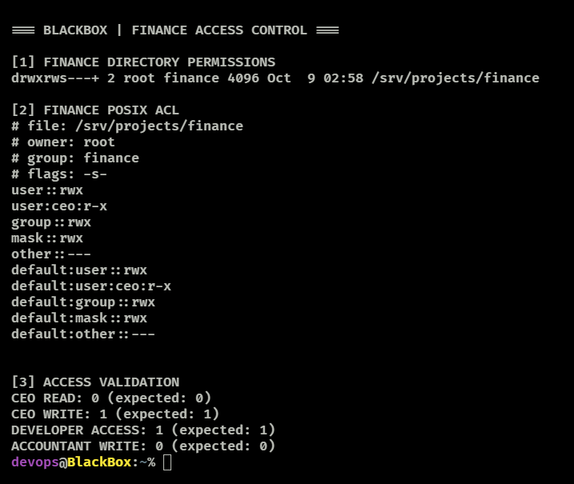

# Permisos de archivos y control de acceso departamental

## Descripción general

BlackBox utiliza propietarios y grupos Linux, el bit SGID en directorios y una lista de control de acceso POSIX (ACL) para administrar los proyectos departamentales ubicados en `/srv/projects/`.

La configuración y las pruebas siguientes se observaron en el servidor del laboratorio. Las comprobaciones validan **el acceso a directorios**, no los permisos de todos los archivos contenidos en ellos.

## Departmental Access Control — SGID & POSIX ACLs

### Directorios y permisos

| Directorio | Propietario | Grupo | Modo | ACL adicional |
| --- | --- | --- | --- | --- |
| `/srv/projects/developers` | `root` | `developers` | `2770` (`drwxrws---`) | Ninguna observada |
| `/srv/projects/finance` | `root` | `finance` | `2770` (`drwxrws---+`) | `ceo: r-x` |
| `/srv/projects/human-resources` | `root` | `human-resources` | `2770` (`drwxrws---`) | Ninguna observada |
| `/srv/projects/management` | `root` | `management` | `2770` (`drwxrws---`) | Ninguna observada |
| `/srv/projects/marketing` | `root` | `marketing` | `2770` (`drwxrws---`) | Ninguna observada |

En estos directorios:

- `root` es el propietario.
- El grupo del departamento dispone de lectura, escritura y ejecución (`rwx`).
- Los demás usuarios no tienen permisos mediante los bits `other` (`---`).
- SGID (`2` en `2770`, o `s` en la posición de ejecución del grupo) hace que los archivos y subdirectorios nuevos hereden el grupo del directorio padre, sujeto al comportamiento del sistema de archivos.
- El signo `+` de `finance` indica la presencia de una ACL extendida.

### Finance: acceso específico del CEO

Se observaron las siguientes entradas ACL:

```text
# file: /srv/projects/finance
# owner: root
# group: finance
# flags: -s-
user::rwx
user:ceo:r-x
group::rwx
mask::rwx
other::---
default:user::rwx
default:user:ceo:r-x
default:group::rwx
default:mask::rwx
default:other::---
```

La ACL nominal concede a `ceo` lectura y recorrido del directorio financiero, pero no escritura en el propio directorio. Las entradas `default` establecen la herencia de ACL para objetos nuevos; los permisos efectivos de cada archivo pueden variar.

### Validación de acceso

Se usó `sudo -u` para evaluar los permisos como cada cuenta. Con `test`, el código de salida `0` indica que la condición se cumple y `1` que no se cumple.

| Cuenta | Comprobación | Código observado | Interpretación |
| --- | --- | ---: | --- |
| `ceo` | `test -r /srv/projects/finance` | `0` | Lectura del directorio permitida |
| `ceo` | `test -w /srv/projects/finance` | `1` | Escritura del directorio denegada |
| `dev1` | `test -x /srv/projects/finance` | `1` | Recorrido del directorio denegado |
| `accountant1` | `test -w /srv/projects/finance` | `0` | Escritura del directorio permitida |

Reproducir las pruebas:

```bash
sudo -u ceo test -r /srv/projects/finance; echo "CEO read access: $?"
sudo -u ceo test -w /srv/projects/finance; echo "CEO write access: $?"
sudo -u dev1 test -x /srv/projects/finance; echo "Developer directory access: $?"
sudo -u accountant1 test -w /srv/projects/finance; echo "Finance write access: $?"
```

Consultar propietarios y ACL:

```bash
ls -ld /srv/projects/*
sudo getfacl -p /srv/projects/finance
sudo getfacl -p /srv/projects/marketing
```

## Evidencias

Añade una captura revisada de las ACL y las pruebas en `../screenshots/finance-acl-validation.png` y después activa esta referencia Markdown:

```markdown

```

## Límites de validación y próximos pasos

Las pruebas respaldan la política de acceso al **directorio** para las cuentas evaluadas. Todavía **no** demuestran que el CEO pueda leer todos los archivos financieros, que los nuevos archivos conserven exactamente la política de solo lectura o que se hayan bloqueado todas las posibles rutas de acceso entre departamentos.

Como siguiente prueba, se recomienda crear archivos temporales de prueba como un usuario de finanzas, inspeccionar el grupo y las ACL heredadas, comprobar la lectura y escritura del CEO sobre esos archivos y eliminar los archivos de prueba al terminar.
