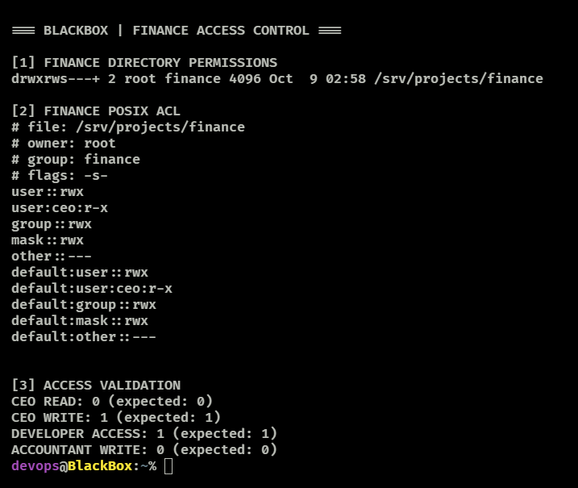

# File Permissions and Departmental Access Control

## Overview

BlackBox uses Linux ownership, group permissions, the set-group-ID (SGID) directory bit, and a POSIX Access Control List (ACL) to manage access to departmental project directories under `/srv/projects/`.

The configuration and access checks below were observed on the lab server. The checks validate **directory-level access**, not the permissions of every file inside those directories.

## Departmental Access Control — SGID & POSIX ACLs

### Directory layout and permissions

| Directory | Owner | Group | Mode | Additional ACL |
| --- | --- | --- | --- | --- |
| `/srv/projects/developers` | `root` | `developers` | `2770` (`drwxrws---`) | None observed |
| `/srv/projects/finance` | `root` | `finance` | `2770` (`drwxrws---+`) | `ceo: r-x` |
| `/srv/projects/human-resources` | `root` | `human-resources` | `2770` (`drwxrws---`) | None observed |
| `/srv/projects/management` | `root` | `management` | `2770` (`drwxrws---`) | None observed |
| `/srv/projects/marketing` | `root` | `marketing` | `2770` (`drwxrws---`) | None observed |

For these directories:

- `root` is the owner.
- The assigned department group has read, write, and execute permissions (`rwx`).
- Other users have no access through the `other` permission bits (`---`).
- SGID (`2` in `2770`, or `s` in the group execute position) makes new files and subdirectories inherit the parent directory's group, subject to filesystem behavior.
- The `+` in the finance directory's long listing indicates an extended ACL.

### Finance: targeted CEO access

The finance directory has the following observed ACL entries:

```text
# file: /srv/projects/finance
# owner: root
# group: finance
# flags: -s-
user::rwx
user:ceo:r-x
group::rwx
mask::rwx
other::---
default:user::rwx
default:user:ceo:r-x
default:group::rwx
default:mask::rwx
default:other::---
```

The named ACL grants the `ceo` account read and traversal permissions on the finance directory without granting directory write access. Default ACL entries define inherited ACL settings for newly created objects; effective permissions on individual files can still vary.

### Access validation

Tests were run using `sudo -u` to evaluate access as the specified account. For `test`, exit status `0` means the condition is true; `1` means false.

| Account | Check | Observed exit status | Result |
| --- | --- | ---: | --- |
| `ceo` | `test -r /srv/projects/finance` | `0` | Directory read check passed |
| `ceo` | `test -w /srv/projects/finance` | `1` | Directory write check failed, as intended |
| `dev1` | `test -x /srv/projects/finance` | `1` | Directory traversal check failed, as intended |
| `accountant1` | `test -w /srv/projects/finance` | `0` | Directory write check passed |

Reproduce the checks:

```bash
sudo -u ceo test -r /srv/projects/finance; echo "CEO read access: $?"
sudo -u ceo test -w /srv/projects/finance; echo "CEO write access: $?"
sudo -u dev1 test -x /srv/projects/finance; echo "Developer directory access: $?"
sudo -u accountant1 test -w /srv/projects/finance; echo "Finance write access: $?"
```

Inspect ownership and ACLs:

```bash
ls -ld /srv/projects/*
sudo getfacl -p /srv/projects/finance
sudo getfacl -p /srv/projects/marketing
```

## Evidence

Add a sanitized screenshot of the ACL and test results at `../screenshots/finance-acl-validation.png`, then enable the following Markdown image reference:

```markdown

```

## Validation limits and next steps

These results support the intended directory-level access policy for the tested accounts. They do **not** yet demonstrate that every file in finance is readable by the CEO, that newly created files preserve the intended read-only policy, or that every cross-department access path is blocked.

Recommended follow-up tests: create disposable test files as a finance user, inspect inherited ACLs and group ownership, verify CEO read/write behavior on those files, and remove test artifacts afterward.
