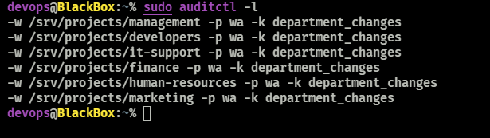
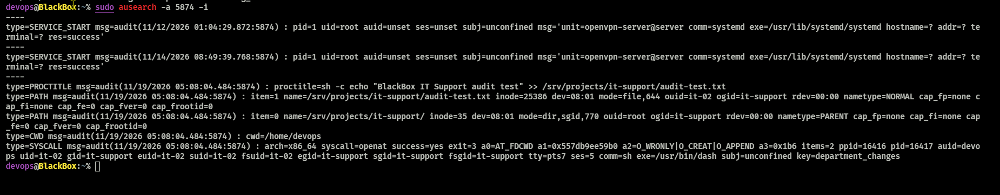
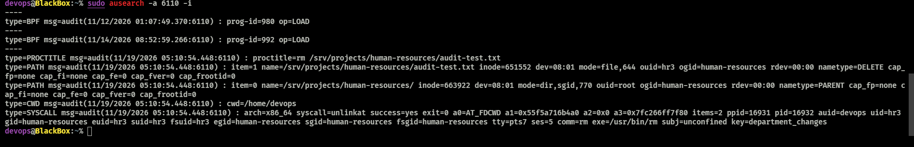

# Auditoría de seguridad — auditd

## Objetivo

BlackBox utiliza Linux Audit (`auditd`) para registrar operaciones de escritura y cambios de atributos en los directorios de proyectos departamentales. Su objetivo es facilitar la trazabilidad y la investigación de incidentes mediante el registro de la ruta afectada, la identidad ejecutora, la llamada al sistema, el resultado y la clave de auditoría.

> **Alcance de la validación:** Se observaron seis reglas de directorio cargadas; se probaron operaciones reales en cinco departamentos. La nueva regla del directorio de Marketing **todavía no se ha validado con una operación sobre archivos**, ni se ha comprobado la persistencia después de reiniciar.

## Directorios monitorizados

Las reglas persistentes se definen en `/etc/audit/rules.d/department-monitoring.rules`:

```text
# BlackBox - Departmental File Auditing
# Monitor write operations and attribute changes.

-w /srv/projects/management -p wa -k department_changes
-w /srv/projects/developers -p wa -k department_changes
-w /srv/projects/it-support -p wa -k department_changes
-w /srv/projects/finance -p wa -k department_changes
-w /srv/projects/human-resources -p wa -k department_changes
-w /srv/projects/marketing -p wa -k department_changes
```

`-w` indica la ruta vigilada; `-p wa` solicita registrar escrituras (`w`) y cambios de atributos (`a`); `-k department_changes` permite buscar los eventos. Las reglas vigilan **rutas, no pertenencia a grupos**: pueden registrar operaciones de cualquier identidad que acceda a la ruta vigilada. No sustituyen SGID, los permisos del sistema de archivos ni las ACL POSIX.

### Carga y comprobación

```bash
sudo augenrules --load
sudo auditctl -l
sudo auditctl -s
sudo ausearch -k department_changes -ts recent -i
```

Se observaron las seis reglas departamentales en `auditctl -l` después de configurarlas. Una comprobación posterior del estado mostró `enabled 1`, `lost 0` y `backlog 0`. Queda pendiente verificar la lista definitiva tras la limpieza y la persistencia después de reiniciar.

## Matriz de validación

Las pruebas se realizaron el **19 de noviembre de 2026**, utilizando `sudo -u` para ejecutar operaciones con cuentas departamentales. Se confirmaron nueve comprobaciones satisfactorias en cinco departamentos.

| Departamento | Cuenta ejecutora | Operaciones observadas | ID de evento | Resultado |
| --- | --- | --- | --- | --- |
| Management | `manager1` | Crear, añadir contenido, cambiar permisos, eliminar | `2075`, `2183`, `2431`, `5557` | PASS (4/4) |
| Developers | `dev1` | Crear | `5674` | PASS |
| IT Support | `it-02` | Crear, añadir contenido | `5867`, `5874` | PASS (2/2) |
| Finance | `subcfo` | Cambiar permisos | `6016` | PASS |
| Human Resources | `hr3` | Eliminar | `6110` | PASS |
| Marketing | — | Nueva regla cargada; prueba de archivo pendiente | — | SIN PROBAR |

### Evento representativo: modificación en IT Support

El evento `5874` registró:

```text
proctitle=sh -c echo "BlackBox IT Support audit test" >> /srv/projects/it-support/audit-test.txt
syscall=openat success=yes
... a2=O_WRONLY|O_CREAT|O_APPEND ...
uid=it-02 gid=it-support auid=devops
key=department_changes
```

Esto demuestra que el archivo se abrió correctamente para añadir contenido bajo `it-02`; el comando también se ejecutó correctamente. El registro de auditoría no muestra por sí mismo el contenido añadido.

### Evento representativo: eliminación en Human Resources

El evento `6110` registró:

```text
proctitle=rm /srv/projects/human-resources/audit-test.txt
nametype=DELETE
syscall=unlinkat success=yes exit=0
uid=hr3 gid=human-resources auid=devops
key=department_changes
```

`uid` identifica la cuenta que ejecuta la operación; `auid=devops` identifica el usuario de inicio de sesión de la sesión desde la que se utilizó `sudo`.

### Evento representativo: cambio de permisos en Finance

El evento `6016` registró `syscall=fchmodat success=yes exit=0`, `a2=0640`, `uid=subcfo`, `gid=finance` y `key=department_changes`. El registro `PATH` mostraba `mode=file,660` durante el evento; `a2=0640` indica los nuevos permisos solicitados. Para buscar el comando es adecuado `ausearch -c chmod`, porque la llamada real fue `fchmodat`, no `chmod`.

### Consultas de eventos específicos

```bash
sudo ausearch -a 5874 -i  # Modificación IT Support
sudo ausearch -a 6110 -i  # Eliminación RR. HH.
sudo ausearch -a 6016 -i  # Cambio de permisos Finance
```

Los ID de evento corresponden al registro original del laboratorio y no serán iguales en otra instalación.

## Capturas de evidencia







> Actualiza la captura de reglas si todavía muestra la antigua regla de laboratorio `marketing_watch`. La configuración final prevista contiene únicamente las seis reglas departamentales.

## Resultados de seguridad (Security Outcomes)

- **Auditoría departamental centralizada:** Seis directorios departamentales están cubiertos por reglas de `auditd` configuradas en `/etc/audit/rules.d/department-monitoring.rules`.
- **Detección de eventos verificada:** Nueve comprobaciones satisfactorias en cinco departamentos demostraron creación de archivos, apertura para añadir contenido, cambios de permisos y eliminación.
- **Trazabilidad de operaciones:** Los registros identifican la ruta afectada, la operación, su resultado, el usuario ejecutor (`uid`), la identidad de inicio de sesión (`auid`) y la clave de auditoría.
- **Configuración de reglas persistentes:** Las reglas departamentales están definidas en el directorio de configuración persistente y se cargaron correctamente en el subsistema de auditoría en ejecución.
- **Estado de auditoría correcto:** La última comprobación con `auditctl -s` mostró `enabled 1`, `lost 0` y `backlog 0`.

Estos resultados demuestran la trazabilidad de la actividad sobre archivos y facilitan la investigación de incidentes junto con los permisos y las ACL del proyecto.
