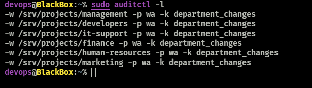
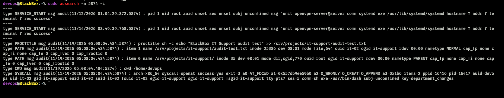
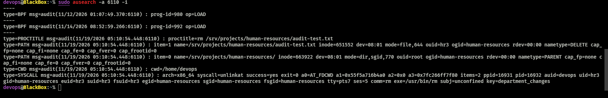

# Security Auditing — auditd

## Objective

BlackBox uses Linux Audit (`auditd`) to record write operations and metadata changes affecting departmental project directories. The goal is to support accountability and incident investigation by recording the affected path, executing identity, syscall, result, and audit key.

> **Validation scope:** Six directory rules were observed loaded; activity was tested in five departments. The new Marketing directory rule has **not yet been validated by a file-operation test**, and survival across a reboot has **not yet been verified**.

## Monitored directories

The persistent rules are maintained in `/etc/audit/rules.d/department-monitoring.rules`:

```text
# BlackBox - Departmental File Auditing
# Monitor write operations and attribute changes.

-w /srv/projects/management -p wa -k department_changes
-w /srv/projects/developers -p wa -k department_changes
-w /srv/projects/it-support -p wa -k department_changes
-w /srv/projects/finance -p wa -k department_changes
-w /srv/projects/human-resources -p wa -k department_changes
-w /srv/projects/marketing -p wa -k department_changes
```

`-w` identifies the watched path; `-p wa` requests auditing of writes (`w`) and attribute changes (`a`); `-k department_changes` provides a searchable event key. These rules watch **paths, not group memberships**: operations by any identity reaching a watched path may be recorded. They do not replace SGID, filesystem permissions, or POSIX ACLs.

### Load and inspect

```bash
sudo augenrules --load
sudo auditctl -l
sudo auditctl -s
sudo ausearch -k department_changes -ts recent -i
```

The six departmental rules were observed in `auditctl -l` after configuration. A subsequent status check reported `enabled 1`, `lost 0`, and `backlog 0`. The final post-cleanup rules listing and reboot persistence should be checked separately.

## Validation matrix

Tests were performed on **2026-11-19**, using `sudo -u` to run file operations under departmental accounts. Nine operation checks were reported successful across five departments.

| Department | Executing account | Observed operation(s) | Audit event ID(s) | Result |
| --- | --- | --- | --- | --- |
| Management | `manager1` | Create, append, change permissions, delete | `2075`, `2183`, `2431`, `5557` | PASS (4/4) |
| Developers | `dev1` | Create | `5674` | PASS |
| IT Support | `it-02` | Create, append | `5867`, `5874` | PASS (2/2) |
| Finance | `subcfo` | Change permissions | `6016` | PASS |
| Human Resources | `hr3` | Delete | `6110` | PASS |
| Marketing | — | New directory rule loaded; file-operation test pending | — | NOT TESTED |

### Representative event: append to IT Support file

Event `5874` recorded:

```text
proctitle=sh -c echo "BlackBox IT Support audit test" >> /srv/projects/it-support/audit-test.txt
syscall=openat success=yes
... a2=O_WRONLY|O_CREAT|O_APPEND ...
uid=it-02 gid=it-support auid=devops
key=department_changes
```

This establishes that the file was successfully opened for append under `it-02`; the command was also run successfully. Audit records do not themselves display the appended file contents.

### Representative event: Human Resources deletion

Event `6110` recorded:

```text
proctitle=rm /srv/projects/human-resources/audit-test.txt
nametype=DELETE
syscall=unlinkat success=yes exit=0
uid=hr3 gid=human-resources auid=devops
key=department_changes
```

The `uid` identifies the executing account; `auid=devops` identifies the originating login identity of the session used with `sudo`.

### Representative event: Finance permission change

Event `6016` recorded `syscall=fchmodat success=yes exit=0`, `a2=0640`, `uid=subcfo`, `gid=finance`, and `key=department_changes`. The `PATH` record reported `mode=file,660` during the event; `a2=0640` records the requested new mode. Use `ausearch -c chmod` to find the command, because the actual syscall was `fchmodat` rather than `chmod`.

### Reproduce focused event queries

```bash
sudo ausearch -a 5874 -i  # IT Support append
sudo ausearch -a 6110 -i  # HR deletion
sudo ausearch -a 6016 -i  # Finance chmod
```

Event IDs refer to the original laboratory log and are not portable to a fresh installation.

## Evidence screenshots







> Update the rules screenshot if it still contains the legacy `marketing_watch` test rule. The intended final configuration contains only the six departmental watches.

## Security Outcomes

- **Centralized departmental auditing:** Six departmental directories are covered by `auditd` rules configured in `/etc/audit/rules.d/department-monitoring.rules`.
- **Verified event detection:** Nine successful checks across five departments demonstrated file creation, append access, permission changes, and deletion.
- **Actionable traceability:** Audit records identify the affected path, operation, execution result, acting user (`uid`), originating login identity (`auid`), and audit key.
- **Persistent rule configuration:** Departmental watches are defined in the persistent rules directory and were successfully loaded into the running audit subsystem.
- **Healthy audit status:** The final `auditctl -s` check reported `enabled 1`, `lost 0`, and `backlog 0`.

These results demonstrate observable file activity and support incident investigation alongside the project's filesystem permissions and ACL controls.
